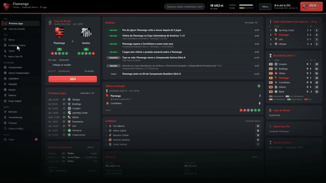
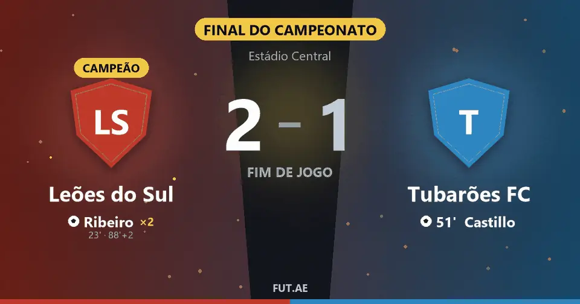
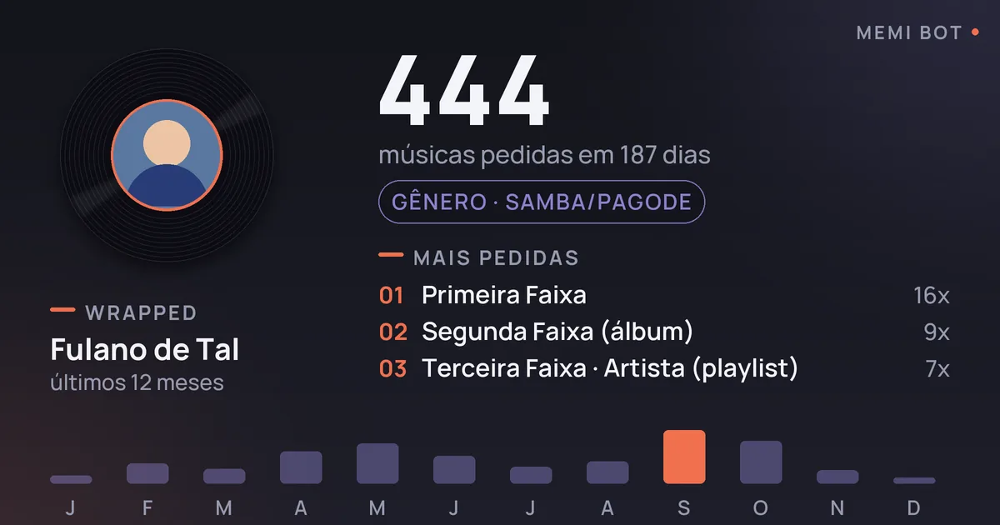
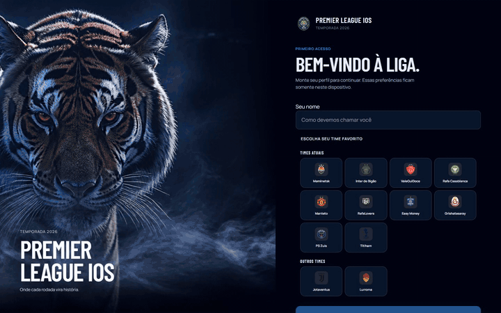

Estudante de **Ciência da Computação na Unisinos**. Faço jogos, bots e sites completos, do banco de dados à interface: um simulador geopolítico em JavaScript, um jogo de técnico de futebol em Java e bots em Python usados todos os dias por comunidades no Discord.

**Procuro estágio ou vaga júnior.** 📫 [gmatzemb@gmail.com](mailto:gmatzemb@gmail.com) · [LinkedIn](https://www.linkedin.com/in/guilherme-matzembacker-017239327/)

## Projetos

<table>
<tr>
<td width="50%" valign="top">

### [ERAS: Simulador do Mundo](https://github.com/GuiMatz/eras)
Simulador geopolítico com mais de 20 cenários, do Império Romano ao mundo em 2150. Guerras, alianças, eleições e Copas do Mundo acontecem sozinhas, e cada partida conta uma história diferente.

`JavaScript` `HTML5 Canvas` `Node.js`
</td>
<td width="50%" valign="top">

### [FUTÉBAS](https://github.com/GuiMatz/futebas)
Jogo de técnico de futebol no espírito do Brasfoot: 224 países, 8.370 clubes e 192 mil jogadores em 2026. Partida ao vivo, tática, mercado e até Kings League.

`Java 21` `JavaFX` `SQLite`
</td>
</tr>
<tr>
<td width="50%" valign="top">

### [FUT.AE Bot](https://github.com/GuiMatz/futae-bot)
Jogo de futebol completo dentro do Discord: roleta de jogadores, elenco, upgrades, trocas, amistosos e campeonatos, com placares e cartas geradas como imagem.

`Python` `discord.py` `SQLite` `Pillow`
</td>
<td width="50%" valign="top">

### [MeMi Bot](https://github.com/GuiMatz/memi-bot)
Bot de comunidade para Discord: rankings, perfis, níveis, patentes, tags e retrospectivas geradas como imagem para os membros do servidor.

`Python` `discord.py` `SQLite` `Pillow`
</td>
</tr>
<tr>
<td colspan="2" valign="top">

### Premier League IOS: [site](https://github.com/GuiMatz/premier-league-ios-site) + [bot](https://github.com/GuiMatz/premier-league-ios-bot)
Liga de Cartola FC entre amigos com site próprio (parciais ao vivo, estatísticas, times e história desde 2023) e um bot que processa as rodadas e publica os dados que o site consome.

`JavaScript` `Vercel` `Python` `discord.py`
</td>
</tr>
</table>

## Ferramentas

**Linguagens:** Python, JavaScript, Java · **Back-end e bots:** discord.py, asyncio, APIs REST, Node.js · **Interfaces e jogos:** HTML, CSS, Canvas, JavaFX · **Dados e qualidade:** SQLite, pytest, Git, GitHub Actions, Maven, Vercel

## Formação

- **Ciência da Computação**, Unisinos (em andamento)
- **Engenharia de Software**, FIAP Nano Course (em andamento)
- **Inteligência Artificial e Computacional**, FIAP Nano Course (60 h)
- **Claude Code 101**, Anthropic · Claude Academy (nov. 2026)
